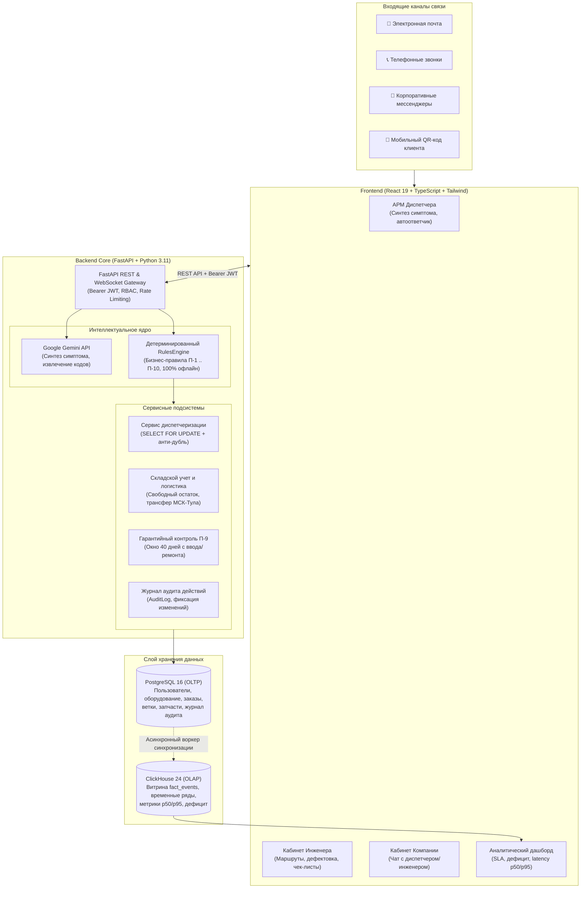

<div align="center">
  
  <h1>«КофеСервис Регион / ServFlow»</h1>
  <p><strong>Интеллектуальная B2B-платформа координации, подготовки и учёта сервисных выездов инженеров</strong></p>

  <p>
    
    
    
    
    
    
    
    
  </p>
</div>

---

> 🏆 **Кейс 06 (Navicon AI Fest 2026):** Автоматизация первичной обработки потока заявок и предотвращение «пустых» выездов сервисных инженеров по ремонту профессиональных кофемашин в Москве и Туле.  
> ⏱ **Опорная дата регламента:** `16.11.2026 11:30` (точка отсчёта для 40-дневного гарантийного окна по правилу П-9, анализа истории ремонтов и складской логистики).

---

## 1. О проекте: цель, ценность и кому помогает

### Проблема бизнеса
В сервисном обслуживании кофемашин до **35% всех выездов инженеров оказываются неэффективными («пустыми»)**:
- Инженер приезжает на объект без нужной запчасти из-за неверной первичной диагностики диспетчером;
- Клиент описывает проблему эмоционально и субъективно («машина шумит, привезите новый насос»), скрывая реальный дефект;
- Заявка оформляется на стороннее оборудование, не находящееся на договоре обслуживания;
- Забываются гарантийные обязательства (повторный ремонт в течение 40 дней должен быть бесплатным, но с клиента ошибочно требуют оплату);
- Не учитывается логистика между складами Москвы и Тулы, что приводит к срыву сроков.

### Решение ServFlow
**ServFlow** — это сквозная экосистема управления сервисным циклом, которая связывает диспетчерскую службу, выездных специалистов, складской учёт и клиентов компании в единый прозрачный контур с ИИ-ассистентом на базе **Google Gemini API** и детерминированным экспертным ядром **RulesEngine (П-1 ... П-10)**.

### Кому помогает платформа:
* 🎧 **Диспетчерам:** 
  Автоматический ИИ-разбор входящих сообщений из почты, звонков и мессенджеров (23 обращения сведены в 13 структурированных веток). ИИ синтезирует объективный симптом, извлекает модель и серийный номер, отсекает догадки клиента, подбирает ремкомплект и назначает инженера с подходящей квалификацией.
* 🔧 **Выездным инженерам:** 
  Персональный адаптивный мобильный кабинет: маршрутный лист, точный адрес, серийный номер аппарата, подтверждённая деталь в резерве багажника, интерактивный чек-лист дефектовки и протокол сдачи работ.
* ☕ **Клиентам (кофейням, ресторанам, отелям):** 
  Личный кабинет организации, мгновенный вход по QR-коду без ввода логинов, чат со службой поддержки и дежурным инженером, прозрачный трекинг статуса выезда.
* 📈 **Руководству и бизнесу:** 
  Экономия сотен часов рабочего времени в месяц, сокращение прямых затрат на логистику (от 250 000 ₽/мес на филиал), аналитика дефицита запчастей и соблюдение SLA.

---

## 2. Архитектура системы

Платформа построена на принципах **чистой модульной архитектуры**, высокой доступности и концепции **Zero Trust Security**.



### Компоненты архитектуры:
1. **Frontend-слой (`frontend/`):**
   - **React 19 + TypeScript:** строгая статическая типизация интерфейса, нулевой runtime-оверхед.
   - **Tailwind CSS + Lucide Icons:** адаптивный интерфейс в премиальном графитовом стиле *Cryptoverse X*, оптимизированный для смартфонов, планшетов и настольных мониторов диспетчера.
   - **Модули интерфейса:** АРМ Диспетчера, Журнал заявок, Кабинет инженера, Кабинет компании, Склад запчастей, Аналитика.
2. **Backend-слой (`backend/`):**
   - **FastAPI (ASGI):** высокопроизводительный асинхронный фреймворк.
   - **Pydantic v2:** строгая валидация входящих и исходящих структур данных.
   - **SQLAlchemy 2:** надёжный ORM-слой с пулом соединений и транзакционной целостностью.
3. **Интеллектуальное ядро (`backend/rules_engine.py` + `backend/routers/ai.py`):**
   - **Гибридный подход:** первичное извлечение сущностей и симптомов нейросетью Google Gemini с обязательной детерминированной валидацией через `RulesEngine`.
   - **100% автономность:** если у Gemini исчерпаны квоты или отсутствует интернет, RulesEngine полностью берёт обработку на себя по встроенным правилам П-1..П-10 без остановки сервиса.
4. **Data Engineering и аналитический контур (`backend/analytics.py`):**
   - **OLTP (PostgreSQL 16):** оперативный контур транзакций (пользователи, чаты, заявки, остатки, блокировки).
   - **OLAP (ClickHouse 24):** колоночная база данных для аналитических витрин (`fact_events`), расчета процента автоматизации, распределения правил и перцентилей задержки (p50/p95).
   - **Отказоустойчивость:** фоновый воркер синхронизации работает прозрачно; при недоступности ClickHouse бэкенд бесшовно переключается на расчет по PostgreSQL.

---

## 3. Регламентные бизнес-правила (П-1 ... П-10)

Система строго соблюдает регламент кейса Navicon AI Fest:

| Правило | Название | Реализация в ServFlow |
|---|---|---|
| **П-1** | **Идентификация оборудования** | Привязка заявки строго к кофемашине из реестра договора. Если у клиента несколько аппаратов (Кафе «Кедр» — №101 и №205), система запрашивает уточнение серийного номера. |
| **П-2** | **Оборудование вне реестра** | Сторонняя техника (Кафе «Ромашка») автоматически передается в коммерческий отдел продаж без назначения инженера и без резервирования запчастей. |
| **П-3** | **Группировка обращений** | Разрозненные сообщения клиента объединяются в единую ветку (23 утренних сообщения кейса сведены в 13 веток). |
| **П-4** | **Синтез описания поломки** | Выделение объективного физического симптома, исключение субъективных догадок клиента («гул», «медленный пролив»). |
| **П-5** | **Инструктаж безопасности** | Запрет опасных действий, рекомендации обесточить аппарат и перекрыть подачу воды при протечках. |
| **П-6** | **Коды ошибок аппаратов** | Распознавание сервисных кодов моделей C100/C200 (`E03` — подача воды, `E07` — привод заварника, `E11` — уровень воды). |
| **П-7** | **Совместимость ремкомплектов** | Подбор запчастей строго по модели аппарата (прокладки `G100`, `G200`, `G300` невзаимозаменяемы). |
| **П-8** | **Складской учет и логистика** | Контроль свободного остатка (`Склад - Резерв`). Доставка между Москвой и Тулой рассчитывается со сроком `+1 день`. |
| **П-9** | **Гарантийное окно 40 дней** | Если с момента монтажа или прошлого ремонта прошло $\le 40$ дней (Ресторан «Пирс» — 13 дней), выезд и запчасти бесплатны, требуется виза старшего инженера. |
| **П-10**| **Запрет разборки клиентом** | Категорический запрет отправки клиенту инструкций по самостоятельному вскрытию оборудования. |

---

## 4. Как запустить проект локально

### Вариант 1. Windows в 1 клик (рекомендуемый для демонстрации)
В корне проекта находится командный файл, поднимающий СУБД, бэкенд и фронтенд:
```bat
start_servers.bat
```
* **Интерфейс системы:** [http://localhost:5173](http://localhost:5173)
* **Документация Swagger API:** [http://localhost:8000/docs](http://localhost:8000/docs)

---

### Вариант 2. Через Docker Compose
```bash
# Стандартный запуск (PostgreSQL 16 + FastAPI + Static React)
docker compose up --build

# Запуск полного контура с аналитической СУБД ClickHouse
docker compose --profile analytics up --build
```
* Приложение открывается по адресу [http://localhost:8000](http://localhost:8000).

---

### Вариант 3. Ручной запуск разработчика

1. **Клонирование и настройка окружения:**
   ```bash
   git clone https://github.com/mihail-grigorev/ServFlow.git
   cd ServFlow
   cp .env.example .env   # убедитесь в наличии STAFF_PASSWORD=1997
   ```

2. **Запуск Backend (Python 3.11+):**
   ```bash
   python -m venv venv
   # Активация: venv\Scripts\activate (Windows) или source venv/bin/activate (Linux/macOS)
   pip install -r requirements.txt
   python -m uvicorn backend.main:app --host 0.0.0.0 --port 8000 --reload
   ```

3. **Запуск Frontend (Node.js 20+):**
   ```bash
   cd frontend
   npm install
   npm run dev
   ```

---

## 5. Тестирование (Testing)

Тестирование платформы организовано в двух взаимодополняющих эшелонах с полным покрытием:

```
====================== 31 passed, 0 failed in 25.63s ======================
ALL 12 INTEGRATION TESTS PASSED WITH 100% SUCCESS!
```

### Структура тестовых наборов:
1. **Модульные тесты Pytest (`tests/`, 31 тест):**
   - `test_baseline.py` (7 тестов) — эталонные данные кейса (12 кофемашин, 10 запчастей, 13 веток, правило П-9 на кофемашине Пирс, правило П-2 на Ромашке).
   - `test_security.py` (6 тестов) — проверка закрытия уязвимостей K1–K6, изоляция IDOR компаний, отсечение эскалации привилегий.
   - `test_duplicate_dispatch.py` (4 теста) — защита от повторного выезда инженера, откат транзакций при нехватке деталей, конкурентное создание заказов.
   - `test_demo_qr.py` (8 тестов) — обмен QR-токенов, валидация срока жизни, ограничение частоты запросов зрителей (Anti-Spam), проверка кода доступа персонала.
   - `test_analytics.py` (5 тестов) — сбор событий в `fact_events`, расчет p50/p95 latency, прозрачный fallback при отсутствии ClickHouse.
   - `test_custom_company_order.py` (1 тест) — создание заказа для незарегистрированных организаций.

2. **Сквозной интеграционный сценарий (`test_suite.py`, 12 шагов):**
   - Выполняет полный реальный жизненный цикл заявки по HTTP: от авторизации диспетчера до ИИ-диагностики, бронирования детали на складе, сдачи акта дефектовки и проверки статики.

### Команды запуска тестов:
```bash
# Запуск всех 31 тестов pytest
python -m pytest tests/ -v

# Запуск сквозного E2E-теста (при работающем бэкенде)
python test_suite.py

# Валидация типов TypeScript и сборки фронтенда
npm --prefix frontend run build
```
Подробный протокол тестирования доступен в документе **[TESTING.md](file:///c:/Users/mihai/Downloads/servflow2/TESTING.md)**.

---

## 6. Безопасность (Security)

Безопасность ServFlow спроектирована по стандарту **Zero Trust** и включает комплексную защиту от угроз матрицы STRIDE:

1. **Аутентификация и изоляция прав (RBAC):**
   - Три строгие роли: `dispatcher` (диспетчер), `engineer` (выездной инженер), `company` (клиентская организация).
   - Пароли хешируются алгоритмом `bcrypt` с динамической солью.
   - Сессии защищены подписанными токенами JWT (HS256) с контролем версии токена (`v`) для мгновенного отзыва всех сессий пользователя.
2. **Защита доступа персонала и секретов:**
   - Код быстрого доступа персонала (`1997`) хранится исключительно в переменных окружения (`STAFF_PASSWORD` в `.env`).
   - Пароли и сервисные коды нигде не отображаются в открытом виде на сайте.
   - Аккаунты компаний изолированы и не принимают код доступа сотрудников.
3. **Защита от состояния гонки (Race Condition / K7):**
   - Предотвращение двойной отправки инженера на одну проблему: атомарные транзакции `SELECT ... FOR UPDATE` и уникальный частичный индекс базы данных:
     `CREATE UNIQUE INDEX uq_orders_active_thread ON service_orders (thread_id) WHERE status NOT IN ('Отменен', 'Отменён');`
4. **Защита от атак на уровне сети и браузера:**
   - **Content Security Policy (CSP):** жесткий белый список источников скриптов, стилей и шрифтов.
   - **Заголовки безопасности:** `X-Frame-Options: DENY`, `X-Content-Type-Options: nosniff`, `Strict-Transport-Security`.
   - **Rate Limiting:** защита от подбора паролей (Brute-Force) и спама в чатах (лимит 10 сообщений в минуту на клиента).
   - **Защита от Prompt Injection:** изоляция клиентского текста служебными маркерами `<<<CUSTOMER_INPUT_START>>>`.
   - **Non-root контейнер:** запуск сервиса в Docker под непривилегированным пользователем `appuser` (UID 1000).

Полная матрица уязвимостей K1–K7 и B1–B10 описана в документе **[SECURITY.md](file:///c:/Users/mihai/Downloads/servflow2/SECURITY.md)**.

---

## 7. Демо-доступ и тестовые аккаунты

Для быстрой проверки системы на защите настроены тестовые профили:

| Роль | Пользователь | Email | Доступ | Назначение |
|---|---|---|---|---|
| **Администратор** | Администратор системы | `admin@kofeservice.ru` | Код **`1997`** | Главный диспетчер, утверждение гарантии, сброс демо-данных |
| **Инженер** | Дежурный инженер | `engineer@kofeservice.ru` | Код **`1997`** | Старший инженер с допусками C100, C200, C300, чек-листы осмотра |
| **Диспетчер** | Анна Соколова | `dispatcher@kofeservice.ru` | Код **`1997`** | Основное рабочее место диспетчера, автоответы ИИ |
| **Инженер (Москва)** | Алексей Иванов | `ivanov@kofeservice.ru` | Код **`1997`** | Выездной специалист по Москве (допуски C100, C200) |
| **Инженер (Тула)** | Сергей Смирнов | `smirnov@kofeservice.ru` | Код **`1997`** | Выездной специалист по Туле (допуски C100, C200, C300) |
| **Компания (Гарантия)** | Ресторан «Пирс» | `client_piers@kofeservice.ru` | 1 клик | Случай гарантии: ввод 03.11.2026 (13 дней, правило П-9) |
| **Компания (Уточнение)** | Кафе «Кедр» | `client_kedr@kofeservice.ru` | 1 клик / QR | 2 аппарата (№101 и №205), кейс уточнения серийного номера |
| **Компания (Обычная)** | Пекарня «Зерно» | `client_zerno@kofeservice.ru` | 1 клик | 2 точки (Садовая и Ленина), отслеживание визита инженера |

> 📱 **Вход по QR-коду:** файл [company_qr.png](file:///c:/Users/mihai/Downloads/servflow2/company_qr.png) позволяет при сканировании камерой смартфона моментально войти в личный кабинет «Кафе «Кедр»».

---

## 8. Лицензия

Проект распространяется под открытой лицензией **MIT**. Подробности в файле **[LICENSE](file:///c:/Users/mihai/Downloads/servflow2/LICENSE)**.
